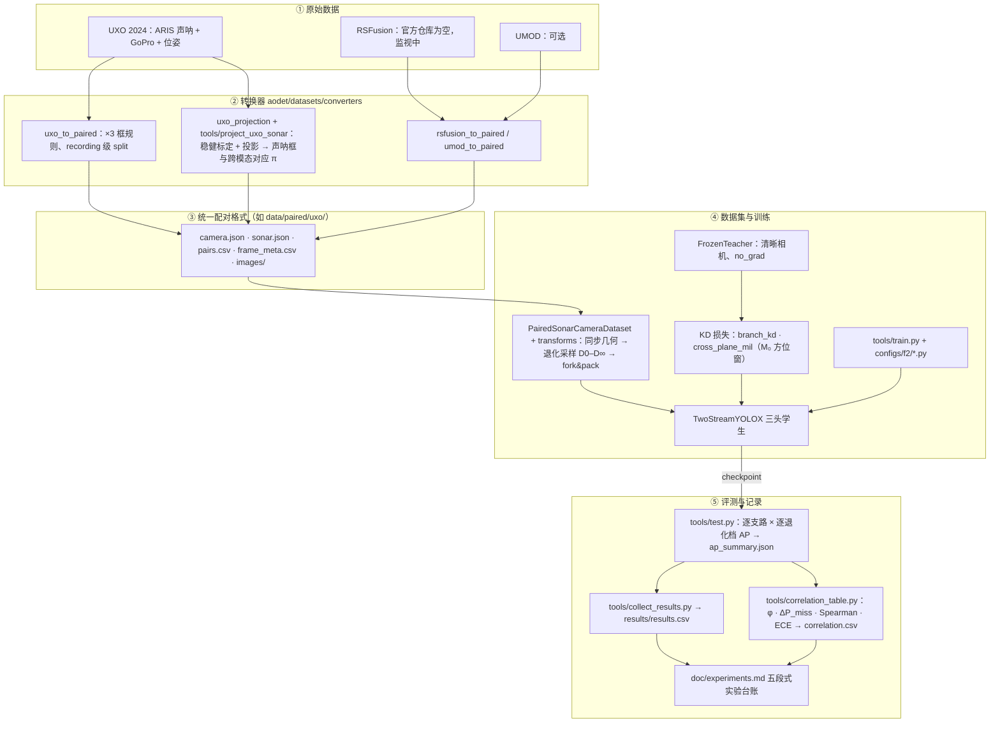

# ao-det — 退化鲁棒的声光融合检测（F2）

[English](README.md) | 中文

水下机器人出海时，前视声呐和相机同时在线。声呐不受浊度影响；相机画质随浊度和光照连续退化，从清水（D0）到重度退化（D4），直到完全不可用（D∞）。本代码库在整条可靠性轴上训练和评测双流声光检测器，回答两个问题：训练期特权蒸馏（教师看清晰相机、学生看退化相机）是否比推理期特征融合更能保住声呐支路；这种"互增强"的代价是什么——两条支路的误差被拉相关了多少，而下游恰恰把两路检出当独立证据用。

完整研究方案：`doc/topic-f2-degradation-robust-fusion-detection-distillation-2026-10.md`；当前主线与路线（2026-11-01 复盘 + 2026-11-02 二次评估，优先读 §0 主线、§8 实施纪律、§9 二次评估）：`doc/f2-rethink-2026-11-01.md`；实验台账（每个实验：设置/结果/解读/结论）：`doc/experiments.md`；搭建过程日志：`doc/logs/`。

基础栈：MMDetection 3.3.0（YOLOX 系）+ mmengine 0.10.7 + torch 2.1.2，版本固定于 `env/`（本机另建 torch 2.7.1+cu128 的 `.venv-gpu` 跑 RTX 5090，见 `env/ENVIRONMENT.md`）。第三方仓库一律不改：`third_party/` 以固定 SHA 只读克隆（`tools/clone_third_party.sh`、`third_party/PINNED.md`）。

## 1. 这份代码要解决什么问题

部署现实：ROV/AUV 上前视声呐与相机同时在线，相机可靠性是连续退化，不是开关。现有方法只覆盖这条谱的两端：纯声呐蒸馏（CMOLD/CMHD，D∞ 端专家，相机清晰时浪费信息）与清水条件下的推理期融合（RSFusionDet 等，从未系统测过退化行为）。清水下融合对单支路的增益只有约 1 AP，提升空间在退化区。另外，库内没有任何声光检测工作报告过支路间的误差相关性，而下游（目标建图/关联）恰恰把逐模态检出当条件独立证据使用，互增强换来的 AP 可能在下游变成过度自信。完整论证见选题文档 §1。

本仓库用同一套框架（MMDetection/YOLOX）、同一份数据、同一个退化协议做受控比较：

| 研究问题 | 一句话 | 在代码里的载体 |
|---|---|---|
| RQ-0（闸门） | 相机退化时，推理期交叉注意力融合会不会拖累声呐支路（互毒害）？ | `s0_cross_attn` vs `s0_b0` 的逐支路 D0–D∞ 扫描（`tools/test.py`） |
| RQ-1 | 对声呐支路，训练期蒸馏与推理期融合谁更有效？ | 方法空间 B1 vs B2/B3 vs M3（§2.3） |
| RQ-2 | 蒸馏收益里"容量收益"（大教小学生）与"特权收益"（教师看清晰、学生看退化）各占多少？ | 2×2 归因：同容量/大教师 × 退化/清晰输入 |
| RQ-3 | 跨平面方位窗蒸馏是否优于逐网格蒸馏？ | `aodet/models/losses/cross_plane_mil.py` |
| RQ-4 | 互增强让两支路误差相关了多少？代价多大？ | `aodet/evaluation/branch_correlation.py` |

## 2. 研究思路

### 2.1 学生模型：双流三头

所有方法共用一个学生骨架 `TwoStreamYOLOX`（YOLOX-S 量级；教师/学生同家族，保证逐预测蒸馏对得上）：

```
camera image ──► cam backbone ──► cam neck ──┬────────────────► camera head          (L_det^c)
                                              │                  训练期被施加 D0–D∞ 退化
sonar  image ──► son backbone ──► son neck ──┼──► fusion ──────► fused sonar head    (L_det^s)
  （永不退化）                                │
                                              └────────────────► uncoupled sonar head (L_det^s0)
                                                                 · 只看融合前的声呐特征，从不接触相机
                                                                 · D∞ 回退头 + 未耦合记账，评测单独报告
```

- camera head 只看相机特征，fused sonar head 看融合特征（默认交叉注意力，声呐查询相机），两个头各自用本模态 GT 监督。
- uncoupled sonar head 是设计关键（选题文档张力 1）：它给出未被相机耦合污染的声呐输出，D∞ 时天然回退，评测时单独记账。
- 去掉相机流（`camera_backbone=None` + `NoneFusion`）即 B0 纯声呐基线，是同一框架内的最强单模态参照。

### 2.2 特权蒸馏

教师固定看清晰相机帧（几何增强师生同步施加），因此其输出可离线缓存；当前为在线 `no_grad` 前向（`FrozenTeacher`），缓存启用前须过等价测试。

```
clear camera frame ──► FrozenTeacher（更大或同容量双流 YOLOX，no_grad）
        │
        ├─ 头输出 objectness + 类别分布 ──► branch_kd ──► 蒸给学生 camera/sonar 头
        │                                   （只蒸 objectness 与类别，不蒸框回归）
        │
        └─ 相机检测框 ──► M₀ 名义几何（相机水平角 → 声呐方位窗）
                            └─► cross_plane_mil：窗内学生声呐头沿距离方向的
                                 最大 objectness 须与教师相符（多示例学习）
                                 · 只传正证据：相机没看到 ≠ 声呐条带没东西
                                 · 窗按 M₀ 标定残差外扩
```

训练分布：每个样本的相机输入按 s~p(s) 从 {D0,…,D4,D∞} 采样（`AOSampleDegLevel`）。D∞ 训练期物化为黑帧（batch 保持稠密，`dinf_mode="zero"`），测试期真正丢相机（batch 1，`dinf_mode="drop"`）。声呐永不退化：声呐配置轴属于兄弟课题 F1，不混入。

### 2.3 方法空间与当前进度

| 家族 | 选题文档编号 | 做法 | 状态（2026-11-01） |
|---|---|---|---|
| 纯声呐基线 | B0 | 声呐单流单头 YOLOX-S | `configs/f2/e09_s0_b0_jitter_yoloxs.py`（E09b）；sample 平台上 test 声呐在地板（类感知 ≤ 0.04） |
| 推理期融合 | ≈B2/B3 | 双流三头 + 交叉注意力，训练期按 p(s) 退化采样 | `configs/f2/e10_b3_degaug_yoloxs.py`（B3）、`s0_b2_cross_attn_nominal_yoloxs.py`（B2）；E09c/E10 声呐双头在地板，RQ-0 不可测 |
| 特权蒸馏 | B1、M1–M5 | 冻结清晰教师 + branch_kd +（M4）跨平面 MIL | E10 M3（τ=2）只有相机支路的方向性正读数，结论已降级；跨模态类别路由（教师相机 → 学生声呐，经 π）待实现，E12 检验 |
| 晚融合参照 | B5 | 两个单模态检测器结果级匹配融合 | 规划中（结构上无耦合，作支路相关性参照） |

完整方法空间（B0–B6、M1–M5）定义见选题文档 §2.2；逐实验进度见 `doc/experiments.md`。

主线状态（2026-11-01 复盘，详见 `doc/f2-rethink-2026-11-01.md`）：E01–E10 修好了一串会让融合/蒸馏结论失真的地基问题（下表），但 sample 平台本身测不了 F2 的核心问题。5 条录音每条恰好一类、每类训练只有一条录音，类别与录音完全绑定；声呐读数一直在地板上；种子噪声（约 ±0.02）与 E10 的判定阈值同量级。E10 的相机正读数来自单条录音（100927）上的类别排序变化，特权、容量、类先验三种来源没拆开，而且 E10 的声呐路由（sonar←sonar）在融合几乎不用相机时原理上传不了特权。调整：研究问题不变，测量平台迁到全量 UXO 的类别均衡录音级划分（E11），先测天花板、平台档位和 σ，再用跨模态类别蒸馏加类先验对照检验 H-cls（E12），主判据回到声呐支路。

| 地基发现 | 不修会对融合/蒸馏造成什么 |
|---|---|
| GT 双尺度中毒：几何投影框横跨半幅而回波紧凑（E04） | 声呐头学不出框，任何 KD 损失都算在错误监督上 |
| 评测别名 bug：两个声呐头共享样本，后算的 fused 覆盖先算的 uncoupled（E07 勘误 2） | 融合 vs 非融合对比的两份预测文件实为同一输出，"融合零影响"是测量假象；已修并加反别名回归测试 |
| KD 损失键不含 "loss" 前缀则 mmengine 不反传（代码审查 §1.1） | M 系列蒸馏损失只记录不训练，实验静默失败；已修，蒸馏从新代码起步 |
| 尺度抖动被固定尺寸 resize 精确抵消（E08 勘误） | 尺度增强类鲁棒性结论必为假阴性；E09b 用修复后抖动确认尺度轴已修 |
| 旧训练配方：无预训练、lr 8×、无 EMA（E07 勘误 3） | B2 vs B0、M1 vs B2 的增益无法归因；E09 起换新配方基线 |
| 录音级域塌缩 + 类别与录音绑定：声光两模态在未见录音上一起塌（E07），sample 每类只有一条训练录音（E08） | 任何方法的声呐读数都落在地板，s 轴效应测不出；对策是全量 UXO 类别均衡划分（E11） |


## 3. 整体架构与数据流

任何源数据集先落入同一套配对格式，之后的数据集、训练、评测代码完全复用：



各阶段要点：

1. 转换：源数据集各写一个转换器（UXO 已全流程跑通，2573 对 + 投影报告；RSFusion/UMOD 转换器就绪待数据）。声呐框没有人工标注，由 `uxo_projection` 用官方位姿做逐 recording 稳健标定后投影生成。训练 GT 只用过门可见回波框（`sonar_gt_sources=("blob",)`；E06 gate：projected 帧按构造无回波），投影框（钳制到回波尺度）保留作跨模态对应 π 与 `gt=all` 评测口径。
2. 配对格式：四个 JSON/CSV + 图片目录就是全部状态；`frame_meta.csv` 把每个 sample 键到两模态 COCO image id、split 与退化种子。
3. 训练：管线顺序固定"同步几何 → 退化采样 → fork&pack"，无 Mosaic/MixUp（师生增强必须同步）；多种子用 `tools/run_seeds.sh`。
4. 评测：`tools/test.py` 逐退化档覆盖数据集 `deg_level` 字段后推理，逐支路落盘预测与 AP；相关性工具只消费这些落盘文件，所有方法共享同一条评测路径。
5. 记录：每个实验按五段式（设置/结果/解读/结论）进 `doc/experiments.md`，当日踩坑与排查链在 `doc/logs/`。

## 4. 目录结构

| 路径 | 内容 |
|---|---|
| `aodet/datasets/` | 配对格式读写（`paired_format.py`）、`PairedSonarCameraDataset`、转换器（`uxo_to_paired`、`uxo_projection`、`rsfusion_to_paired`、`umod_to_paired`）、变换（同步几何、相机退化 D0–D∞、fork & pack） |
| `aodet/models/` | `TwoStreamYOLOX`（三头，`detectors/`）、融合模块（`fusion/`：cross-attn / concat / none）、KD 损失（`losses/`：`branch_kd`、`cross_plane_mil`）、冻结教师（`teachers/`）、`PairedDataPreprocessor` |
| `aodet/evaluation/` | 逐支路 COCO AP（`per_branch_metric.py`）、支路误差相关性（`branch_correlation.py`：φ、ΔP_miss、Spearman、朴素贝叶斯融合、ECE） |
| `aodet/geometry/` | M₀ 相机→方位映射 + 翻转镜像（`m0.py`）、ARIS 波束表 |
| `configs/` | `_base_`（模型/数据/调度/运行时）+ `f2/` S0-lite 配置（B0、cross-attn） |
| `tools/` | `train.py`、`test.py`（逐支路 D0–D∞ 扫描，支持按 split/逐录音/逐类输出）、`project_uxo_sonar.py`（标定+投影，指纹键控缓存）、`uxo_inventory.py` / `split_uxo_recordings.py`（E11 录音清点与冻结划分）、`anatomy.py` / `camera_anatomy.py`（逐录音逐类解剖）、`download_uxo_full.sh`（全量 UXO 下载+md5 校验）、`check_gt_validity.py`、`make_degraded_testsets.py`、`run_seeds.sh`、`run_loocv.sh`、`collect_results.py`、`correlation_table.py`、第三方 pin、RSFusionDet 监视 |
| `tests/` | 282 项测试（2026-11-04 收集数）：退化物理、格式往返、几何、指标（含已知答案测试）、模型、UXO 转换器/投影/标定缓存、E11 工具（清点/划分/逐 split 评测）、断点续训兼容、端到端管线与工具 |
| `env/` | 安装脚本 + `ENVIRONMENT.md` 版本记录 |
| `doc/` | 选题方案、复盘 `f2-rethink-2026-11-01.md`、实验台账 `experiments.md`、过程日志 `doc/logs/`、代码审查 `doc/reviews/`、证据存档 `doc/evidence/` |
| `data/paired/` | 转换后的配对数据（UXO：2573 对 + 投影报告与拼图） |

## 5. 快速开始

```bash
source .venv/bin/activate
python -m pytest tests/ -q          # 282 tests collected (2026-11-04)

# S0-lite（UXO sample 已转换至 data/paired/uxo/）
python tools/train.py configs/f2/s0_b0_sonar_only_yoloxs.py --seed 0
# mmengine 只写 epoch_N.pth + last_checkpoint（没有 latest.pth 软链）
ckpt=$(cat work_dirs/s0_b0_sonar_only_yoloxs_seed0/last_checkpoint)
python tools/test.py  configs/f2/s0_b0_sonar_only_yoloxs.py "$ckpt" \
    --out-dir work_dirs/s0_b0_sonar_only_yoloxs_seed0
python tools/collect_results.py work_dirs --out results/results.csv
```

## 6. 配对格式（所有源数据集共用一套布局）

```
<root>/camera.json  sonar.json  pairs.csv  frame_meta.csv
<root>/images/camera/...  images/sonar/...
```

`frame_meta.csv` 把每个 `sample_id` 键接到两个 COCO image id、split 与退化种子；`read_paired` 负责 CSV 类型归一。同步翻转仅当声呐方位轴 0° 居中时合法（`sonar_zero_centred=True`）。

## 7. 退化协议

`aodet/datasets/transforms/camera_degradation.py`：物理有序算子（衰减 → 波长吸收 → 散射雾幕 → 模糊），级别 D0–D4、D∞（全黑/传感器缺失），按 (sample_id, level, seed) 确定性生成。训练按 p(s) 抽级别（F2 §5.2），D∞ 物化为黑帧（`dinf_mode="zero"`，batch 保持稠密）；测试期 D∞ 丢弃相机（`dinf_mode="drop"`，batch 1）。离线固定测试集：`tools/make_degraded_testsets.py`（逐级别 sha256 manifest）。

## 8. 评测

基于保存的预测文件按退化级别出逐支路 AP（`tools/test.py` → `pred.<branch>.<level>.json` + `ap_summary.json`）。声呐支路同时报全量 GT 与 blob 子集两个口径（`gt=all` / `gt=blob`）：投影框带标定距离维误差，blob 子集是干净参照。支路误差相关性（φ、带 bootstrap 置信区间的条件漏检升幅 ΔP_miss、Spearman 置信相关、朴素贝叶斯融合存在性 ECE）实现在 `aodet/evaluation/branch_correlation.py`，经 `tools/correlation_table.py` 对 run 目录输出 `correlation.csv`。

## 9. 状态（2026-11-02）

- 环境与管线：COCO YOLOX-S 复现门通过（AP 40.30 vs 官方 40.5）；本机 RTX 5090 用 `.venv-gpu`（torch 2.7.1+cu128，见 `env/ENVIRONMENT.md`；torch ≥ 2.6 的 weights_only 默认值由 `aodet/torch_load_compat` 的 scoped 包装处理，断点续训不再依赖环境变量）。
- 数据：UXO sample 已转换为 `data/paired/uxo/`（2573 对；镜像盆修复后重标定为 blob 1319 / projected 1254），训练 GT 用 blob-only。全量 UXO 下载在途：data_processed.7z（57 GiB）已 md5 校验（11-02 05:32），两个 16 GB 导出包在途（`data/raw/uxo-full/download.log`）。
- 实验：E01–E10 记录在 `doc/experiments.md`。E10 已按复盘降级为方向性读数；τ 消融 tau1 已出数、tau4 断点续训在跑（事故与恢复见 `doc/logs/2026-11-02-tau4-resume-weights-only.md`），出数只入账不解读。
- 主线（2026-11-02 二次评估写定，复盘页 §0）：相机退化时，相机信息经融合或蒸馏进入声呐支路，收益多少、来自特权还是容量、代价（支路误差相关）多大。先证明有东西可传（融合活性、融合余量、互毒害），再做归因，再测相关性。
- 下一步：E11（全量 UXO 类别均衡划分 + B0/B2/B3 三种子）已预登记，代码前置项全部落地（21f1345 + 6e2043a）。2026-11-02 二次评估给 E11 补了融合活性、融合余量、类别移植上界和 mAP@[.5:.95] 读数；分段训练（B0 ×3 → B2 ×3 → 条件触发的 B3 ×3）与 val-ID 交错时间块（`uxo_to_paired --val-id-mode interleaved`）已于当日采用，均在划分落盘前生效。数据到位后的管线：解压 → 2 条录音适配验证 → 转换 → 标定（指纹缓存可断点）→ 清点 → 冻结划分 → 数据闸门 0。train 侧 resume 的 scoped weights_only 修复已收口（train/test 共用 `aodet/torch_load_compat`，附 save-then-resume 冒烟测试，见事故记录）。
- 二次评估的三条主要风险（复盘 §9.2）：现有交叉注意力融合是惰性的（E10 融合声呐头 d0–D∞ 逐档同值）；按 CMHD 同协议读数，E11 大概率落在天花板档；E12 的跨模态 logit 蒸馏在单目标数据上近似重复监督，须改用折外教师并加标签平滑对照。
- 待决：困难子集定义（须在 val 开封前写定）；E11 落在天花板或地板档时论文定位，天花板档可能性最大，建议现在就定（复盘 §3.5、§9.2 b）；E11 计入 G0，E12 起超出选题 G0 授权，需用户和指导人确认（复盘 §0、§7）。
- RSFusionDet 仓库仍为空（每两周核验，`doc/logs/rsfusiondet-watch.log`）。
