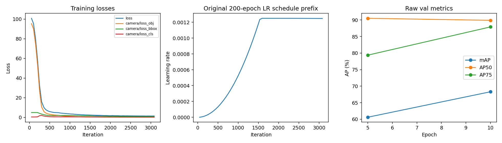
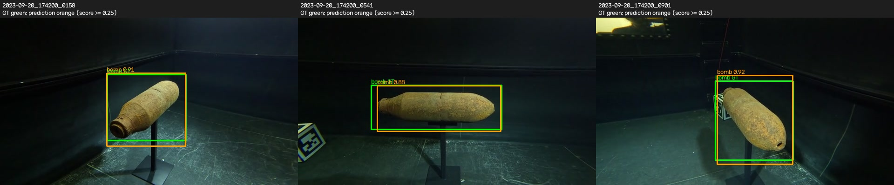
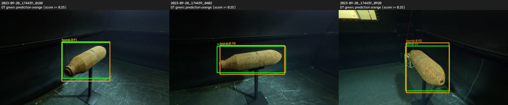
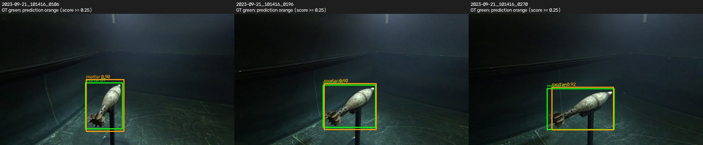
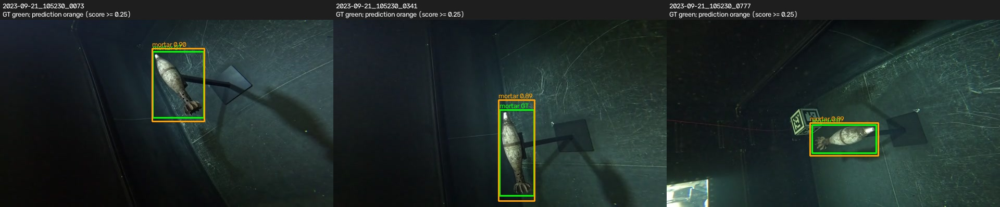
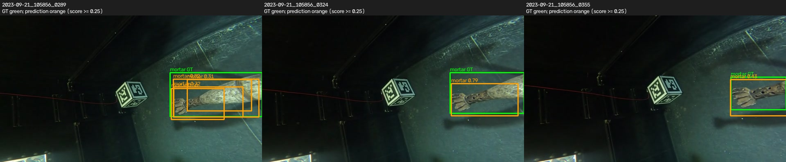
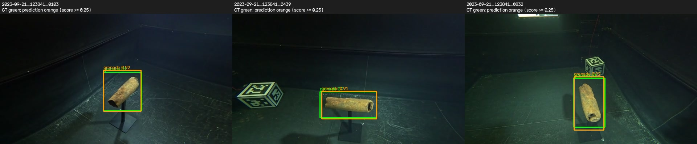
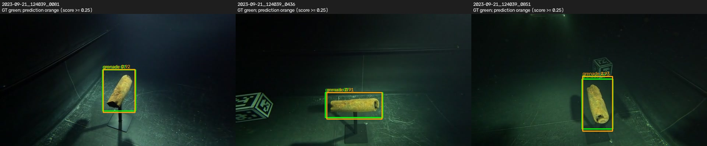
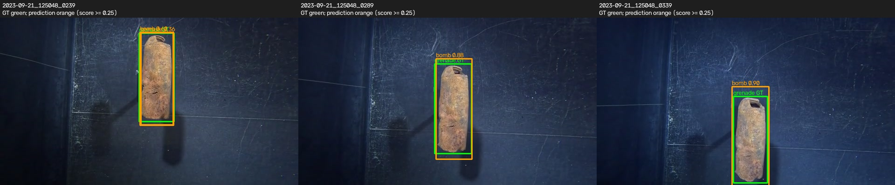
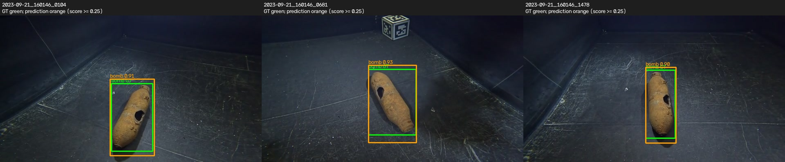

# Camera-only YOLOX-M short pilot

10 epochs; raw weights; fixed COCO initialization; val only.

| Epoch | mAP@[.5:.95] | AP50 | AP75 |
|---|---:|---:|---:|
| 5 | 60.61 | 90.52 | 79.38 |
| 10 | 68.31 | 89.91 | 87.92 |

Fixed first/middle/last sample from every val recording; no test.

