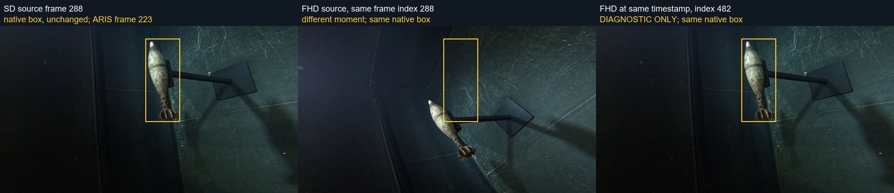

# 完整本地源的 SD/FHD 时间错位原因审计

日期：2026-11-10。性质：只读来源与数据管线诊断；不训练、不评价模型、不改标签或 split。

结论：**错位已经存在于发布的 SD/FHD 视频之间；官方导出链在切换分辨率后复用了帧序号，因而取到了不同时间的画面。** 完整本地源把这一现象从两条问题录音扩展到了允许审计的40条录音中的38条。38是视频时间不一致的录音数，不是坏标签比例，也不表示每条录音的每个框都错。

视频最初为何产生起点差尚无历史日志可定案。当前有证据支持的候选解释是：不同分辨率视频在编码后又分别做过非逐帧精确裁剪，开始位置落到了不同关键帧；也可能混用了不同裁剪版本。受控裁剪可以重现该类现象，单纯缩放控制没有重现。不能把这个解释升级为已证实的历史命令。

## 范围与来源

- 本地完整源：`D:/pby/data_processed/`，含 `matches.csv` 及 SD/FHD/UHD 各76段视频；本轮没有解码全部76段。
- 范围取自 [gallery manifest（本地产物说明）](../../../ARTIFACTS.md#artifact-e93ca666d72e) 的 `provenance.approved_recordings`：40条开发录音，与 matches.csv 一一映射到40个唯一视频 basename。只检查这40条；不打开 test 视频、test 图像或 test 标注。
- 120个流做 ffprobe 元数据读取；80个 SD/FHD 流解码为160×90灰度序列用于内容核对；两条已定位问题的 UHD 做首批帧及短片控制。
- 归档已有官方 MD5 校验。前轮四段 SD/FHD 的本地文件 size/CRC 与归档匹配、matches.csv 与此前官方副本一致，见 [来源核对](../../../related_work/uxo/sd-fhd-trace/local-extracted-source-check.json)。本轮没有声称对所有解压成员逐文件重新校验。
- 原研究目录和原始视频只读；所有输出都在 workflow。原始 LabelMe 工程仍未找到。

## 已实测的时间与内容差异

| 录音 | SD 起点/s | FHD 起点/s | FHD−SD/s | 对应帧差 |
|---|---:|---:|---:|---:|
| 2023-09-21_101622 | 3.551 | 5.687 | +2.136 | +64 |
| 2023-09-21_103140 | 6.714 | 0.241 | −6.473 | −194 |
| 2023-09-21_110411 | 0.337 | 4.942 | +4.605 | +138 |

前两行是用户问题录音。第三行用于展示其他录音也有数秒差异；具体值由原始 [逐录音表](full-source-timing/recording-timing.csv) 复核，不能当作全局校正参数。

汇总结果：

- 40/40录音内部的SD/FHD fps相同；其中39组为 `30000/1001`，`2023-09-20_173329` 一组为 `60000/1001`。38/40起点差超过半帧。
- 40/40 满足 `round((FHD_start−SD_start)×fps) = SD帧数−FHD帧数`。结束时间差的绝对值最大0.000933秒，远小于一帧。
- 元数据给出的偏移方向得到图像内容支持：按固定规则抽取2,992对帧，38条非零偏移录音中，时间对应帧的灰度MSE中位数全部低于同序号帧。所有40组解码帧数都与流的 `nb_frames` 一致，无解码失败。
- 两条零偏移录音为 `2023-09-21_101131` 和 `2023-09-21_124039`；其时间对应与同序号比较相同，作为内部对照。

内容核对没有读取 bbox，也没有搜索最优偏移。先由 start_time 独立计算整数偏移，再每20帧抽样比较。为同时容纳同序号/偏移两种对照，采样限制在两者都有效的子集；不是完整重叠区间逐帧验证。灰度比较消除了逐帧均值，分辨率压缩到160×90；它支持时间对应，不替代目标边界和逐框质量验收。原始结果见 [pixel-correspondence.json](full-source-timing/pixel-correspondence.json)。

令 `delta = round((FHD_start−SD_start)×fps)`，则已验证的关系是：

```text
FHD[j] 约对应 SD[j + delta]
SD[i] 约对应 FHD[i − delta]
```

因此，103140 的 SD 第288帧对应 FHD 第482帧，而不是 FHD 第288帧。原框不动，改看正确时刻，目标便回到框内；这不是把框在图上平移。下面是前轮保留的诊断副本，没有替换训练输入：



前轮27个固定导出JPG查询、三个问题框的核对及其局限详见 [两条录音的直接证据](sd-fhd-temporal-mismatch-findings.md)。本轮没有把40条视频的时间对应证据扩写成40条完整标注工程已验证。

## 官方代码如何把视频起点差传播成图—GT错位

以下是公开仓库固定提交 `323ac6cf45bb6129806c8e3ed8ec31e22e1a392d` 的代码事实，不是对发布者运行历史的猜测。

1. `prep_x_match_recordings.py` 的匹配入口优先选择 `clips_sd`。
2. `matching_context.py` 以 ARIS 时间、onset 和 `gopro_offset` 计算帧序号，再通过 `CAP_PROP_POS_FRAMES` 取图。
3. `release_1_export.py` 导出 FHD 时替换分辨率目录，却继续使用同一组 onset/offset，未补偿 SD/FHD 的不同起点。
4. 于是，SD 上得到的帧号用于 FHD 时取到另一个时刻；标签坐标乘3只改变空间尺度，无法补偿时间错配。

固定源码见 [matching_context.py](../../../related_work/uxo/sd-fhd-trace/matching_context.py)、[release_1_export.py](../../../related_work/uxo/sd-fhd-trace/release_1_export.py)、[匹配入口](../../../related_work/uxo/sd-fhd-trace/prep_x_match_recordings.py)。前轮已确认问题JPG/JSON与官方发布归档相符；不能归因为本地gallery画框或paired转换新引入的问题。

## 为什么怀疑编码后的独立裁剪

公开 [裁剪脚本（本地产物说明）](../../../ARTIFACTS.md#artifact-12e77cb26d77) 使用 `-ss/-to` 配合 `-c copy`，注释说明最终导出曾收紧片段范围。公开 [缩放脚本（本地产物说明）](../../../ARTIFACTS.md#artifact-274c42251fed) 则从 UHD 转成不同分辨率。这些脚本本身不能证明发布文件严格按当前脚本顺序生成。

另有可执行性缺口：公开缩放脚本的 `for res in "$resolutions"` 不会按IFS把配置 `sd+fhd` 拆开；当前38行快照仅有一个 `done`，两个循环未完全闭合。这里只做静态检查，没有执行该原脚本。这进一步限制了将公开源码视作历史实际成功流水线的可信度；不能擅自修补它再声称忠实重放。

本轮控制只产生 workflow 内诊断短片，命令、工具版本、probe与stderr全部保留：

| 控制 | 实测 | 可支持的结论 |
|---|---|---|
| 同一UHD、共享decoder、同时输出SD/FHD，限制8秒 | 两路均 start=0.300300、231帧 | 单纯共享输入缩放没有产生数秒差 |
| 两条UHD，各自用独立FFmpeg进程缩放SD/FHD，限制8秒 | 101622两路均0.300300/231帧；103140两路均0.900900/213帧 | 在当前软件与这两段首部，单纯分别缩放也没有产生差异 |
| 对已编码SD/FHD分别用相同 `-ss/-to -c:v copy` 裁剪 | 如103140请求20–30秒，SD输出start=5.025、152帧，FHD输出start=5.266、144帧；另外三组成对控制也有不同起点 | 相同裁剪请求可以因编码后关键帧位置不同而保留不同开头；重现了“同终点附近、不同开头”的同类机制 |

见 [裁剪与共享输入控制](full-source-timing/controls/control-results.json)、[独立缩放控制](full-source-timing/controls/independent-scale-results.json)。这些输出的 start_time 是各控制文件的时间轴数值，不可直接当成源视频的绝对时间或新的修复量。

裁剪控制的输入本身就是已存在起点差的SD/FHD，证明的是该操作能够产生或改变时间起点差，并非从统一对齐源重放完整“独立编码→裁剪”历史。它不能单独排除其他编码、容器或编辑步骤。

额外线索：两条问题录音的 SD/FHD 首包均标记为关键帧；UHD首60个解码帧可读取，没有发现缺参考帧警告。40条中3条 FHD 帧数超过同名当前UHD，其中103140多22帧。仅凭帧数不能排除转码补帧、历史裁剪版本等情况，但这不支持把当前三个分辨率文件简单认作严格逐帧缩放副本。

所以，“编码后分别重新裁剪/混用裁剪版本”是目前有机制控制支持的解释。**仍未知的是具体哪次操作、当时完整输入、FFmpeg版本和命令，以及LabelMe工程使用的精确视频版本。** 当前控制不能补造这些历史事实，也不能排除其他处理步骤。

## 对当前研究的影响与取舍

1. 先冻结一套具有可验证时间对应的 camera 图像—标签版本，再开展 recording-level split 的教师实验。仅重新下载相同发布数据不会修复导出关系。
2. 不整体平移框、不凭检测器预测修GT、不把一个录音的帧差套到其他录音。需要重建时优先从经验证的共同时间基准取图；SD↔FHD没有重叠覆盖的片段不能外推。
3. 38条时间不一致不等于所有帧均错：运动幅度、遮挡、对象大小会影响可见偏差，原始框本身也需另行QA。
4. 这为现有教师泛化问题提供了具体数据质量风险，尚未量化其AP影响，不能宣称是全部性能差距的唯一原因。旧分数保留，不能当作已验证干净GT的性能。
5. 原始LabelMe工程和历史处理日志仍列为缺失证据。本轮止于原因审计，没有重建训练集、修改现有GT、选择新split或启动训练。

## 可复核产物与记录更正

- [审计预登记](full-source-timing-plan.md)：范围、对照、停止条件及控制追加目的。
- [元数据汇总](full-source-timing/summary.json)、[逐录音CSV](full-source-timing/recording-timing.csv)：120份原始probe在同目录。
- [像素核对](full-source-timing/pixel-correspondence.json)：40条记录、2,992个抽样对照。
- 工具：[元数据](../../../tools/audit_full_local_video_timing.py)、[像素](../../../tools/audit_allowed_video_pixel_timing.py)、[裁剪控制](../../../tools/probe_timing_pipeline_controls.py)、[独立缩放](../../../tools/probe_independent_uhd_scale.py)。

更正与继承：前轮“仅两条有像素对应证据，其余未知”是当时状态；本轮新增38条非零偏移录音的抽样内容支持。元数据汇总文件中的 `pixel_correspondence_confirmed` 是生成元数据时仅两条的历史标记；最新内容证据以单独的 pixel-correspondence.json 为准，不据旧布尔字段否定本轮核对。历史报告保留，不静默改写。最初剪辑操作仍保持未知，新增的是有控制支持的候选机制。
