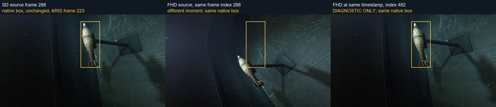

# 已实测定位：SD/FHD片段起点不同，复用帧序号导致camera框错位

2026-11-10。用户要求追查原始标注工程及SD/FHD帧对应，禁止直接平移整批框。本报告接续[上一轮原因追溯](mortar-camera-cause-review.md)，以新增视频证据收缩原因；旧报告保留，不回写其当时未知状态。未修改原研究、原图、原标签或split，未训练、未评价模型、未解码test/无关视频。

## 1. 结论与适用范围

**这两个recording存在可直接验证的SD/FHD时间起点差异。原始框在官方匹配表所指的SD画面上能够包住目标，但把同一帧序号用于FHD，会取到另一个时刻，从而出现用户看到的错位。** 三个具体问题例子均已复现这条链。

这使原因从“人工画框错误或帧对应错误皆未知”推进到：**在本次核验的两个recording中，分辨率切换时没有保持同一时刻，是已实测的直接原因。** 尚未找到原始LabelMe工程；也没有定位哪次历史裁剪/转码命令造成两套视频的起点不同。不能据此把所有camera错误、所有recording或模型泛化差距都归为该原因。

这不是像素坐标上的统一平移。目标随时间改变位置与姿态，两条录音的时间差还方向相反。诊断图只用于展示同一时间的画面，未用于替换训练图或修标签。

## 2. 真正取到的来源

使用官方Zenodo归档目录定位，并按归档size/CRC32核验了两个SD和两个FHD视频以及matches.csv。解出的四段视频合计66,636,160 bytes，均在workflow的`DataSet/camera_annotation_trace/`内；未在原研究写入文件。

| recording | 官方matches.csv的SD视频 | aris_onset | gopro_offset |
|---|---|---:|---:|
| 2023-09-21_101622 | clips_sd/20230921_GX010012_04.mp4 | 74 | −4 |
| 2023-09-21_103140 | clips_sd/20230921_GX020012_02.mp4 | 82 | −2 |

FHD视频为同名的`clips_fhd/`文件。这里−4/−2是匹配表原有参数，不是本轮发现的64/194帧差，不能混用。

来源证据：[匹配表校验及两行记录](../../../related_work/uxo/sd-fhd-trace/matches-metadata-verification.json)、[SD视频校验](../../../related_work/uxo/sd-fhd-trace/sd-clip-extraction.json)、[FHD视频校验](../../../related_work/uxo/sd-fhd-trace/fhd-clip-extraction.json)。CRC32+size是归档文件身份核查，不冒充完整远端逐文件SHA-256；本地提取件的SHA-256另存。

## 3. 视频元数据已经显示了不等价

两套视频的帧率相同，均为30000/1001（约29.970 fps），但片段开头不同。表中start_time是**MP4流时间轴上的起点**，不是采集日期或UTC墙钟时间。

| recording | SD start_time / 帧数 | FHD start_time / 帧数 | FHD相对SD起点 | 对应帧差 |
|---|---|---|---|---:|
| 2023-09-21_101622 | 3.551秒 / 1620 | 5.687秒 / 1556 | 晚2.136秒 | +64 |
| 2023-09-21_103140 | 6.714秒 / 1450 | 0.241秒 / 1644 | 早6.473秒 | −194 |

两套各自的结束时间近乎相同（亚毫秒级封装差），帧数差分别为64和194，与起点差相符。该判断不依赖观察框好坏，也没有通过最大化IoU来选择偏移。

完整ffprobe结果及像素核查：[source-timing-verification.json](sd-fhd/source-timing-verification.json)、[101622 FHD probe](sd-fhd/2023-09-21_101622-fhd-ffprobe.json)、[103140 FHD probe](sd-fhd/2023-09-21_103140-fhd-ffprobe.json)。对应SD probe在同目录`*-ffprobe.json`。

## 4. 用实际解码画面交叉核验

使用固定的跨时段样本：两条录音各12个等间隔native帧，另加用户三个问题帧，去重后13+14=27个查询。预登记见[诊断登记](sd-fhd-trace-plan.md)。

- 发布FHD JPG在对应官方FHD视频中的最近画面，27个查询中26个与匹配表取帧规则的预测序号一致，另一个差1帧。由于导出ARIS元数据缺少onset的原始行，时间原点在此处是按中位帧间隔外推，不能把这1帧宣称工具错误。
- 101622的13个查询，同一画面在SD中的序号始终比在FHD中多64。
- 103140可比区间的12个查询，同一画面在SD中的序号始终比在FHD中少194；最前两个查询在SD有效覆盖之前，没有可靠的同画面对应，不能把最近像素候选当成真实匹配。
- 独立按视频start_time计算64/−194，再对完整重叠区间每10帧抽查：101622为156对、103140为145对。时间对应后的160×90去均值灰度MSE中位数分别约1.225和1.183；直接使用同序号则约233.078和329.609。这是像素对应诊断，不是检测分数或标注质量指标。

**关键三例：原始框不改一像素。** 以下SD/FHD均指源视频中的0基帧序号，和ARIS文件名中的frame_idx不是同一个坐标系。

| 原始sample_id | 按匹配规则取SD | 同序号取FHD（错位） | 对应同一时间取FHD（诊断） |
|---|---:|---:|---:|
| 2023-09-21_101622_0822 | 1513 | 1513 | 1449 |
| 2023-09-21_103140_0223 | 288 | 288 | 482 |
| 2023-09-21_103140_0309 | 464 | 464 | 658 |

SD画面和右列FHD画面中，原框能覆盖目标；中列出现用户报告的错位。这是保留标签坐标、只查画面时刻的直接反证，不需要先认定人工画框错。

其余：[101622例](sd-fhd/2023-09-21_101622_0822-source-timing-proof.jpg)、[103140另一例](sd-fhd/2023-09-21_103140_0309-source-timing-proof.jpg)。所有右列图片明确标DIAGNOSTIC ONLY，未进入数据集。

## 5. 公开处理链中的具体风险

本轮核查的官方代码commit为`323ac6cf45bb6129806c8e3ed8ec31e22e1a392d`。文件快照/hash与完整42路径代码树见[official-source-tree.json](../../../related_work/uxo/sd-fhd-trace/official-source-tree.json)。

1. `prep_x_match_recordings.py`优先用`clips_sd`做人工匹配，matches.csv保存的是SD路径及帧单位的gopro_offset。
2. `release_1_export.py`按配置将路径替换为`clips_fhd`，继续设置同一aris_onset与gopro_offset。
3. `MatchingContext.aristime_to_gopro_idx`根据ARIS相对时间、当前视频fps和offset计算帧序号，`get_gopro_frame`按序号seek；分辨率切换代码没有补偿SD/FHD的不同start_time。
4. 两套起点不同但复用同一帧序号，正好解释了本次发布JPG与SD标签的时间不一致。

这是当前公开实现与发布素材共同支持的机制；公开源码不等于发布时完整运行日志。尚不能确定起点差是在哪次裁剪、转码或素材替换中产生，更不能直接写成某一条FFmpeg命令或某个人操作的已证实错误。

## 6. 原始标注工程找到了吗

**没有找到。** 检查范围明确如下：

- 当前官方GitHub代码树42个路径：有导出、匹配、缩放与查看工具，无这批标签的LabelMe工程或label生成/重命名代码。
- `data_export_recordings.7z`目录：提供FHD JPG、五字段扁平标签JSON、ARIS与gantry元数据；本次检查的JSON没有原始工程的imagePath/shapes/version等字段。
- `data_processed.7z`的198,915个成员目录：有228个mp4，分布于SD/FHD/UHD三套片段，及csv/yaml/pgm/png；没有JSON/XML工程文件。
- 本地原研究与D:/pby范围内的前置文件名检索没有找到现存原始SD/FHD视频或LabelMe工程；本次视频是从官方包按需取出。

这些是“在检查的入口未找到”，不是断言作者从未保留工程。缺少工程不妨碍本次确认视频时间覆盖不一致，但会限制对所有框质量和最初标注过程的审计。

## 7. 更正与后续边界

更正前报告中“人工画错与帧错配均未知”的宽泛判断：现在对这两个recording有直接的SD/FHD帧对应证据；三个问题例子原框在SD上合理，不能继续把它们简单归为人工画错。

尚未做也不应直接做的事项：

- 不把64或194当成像素位移，不能平移所有bbox。
- 不把同一个时间差套到其他recording；必须逐段核查来源、start_time、帧数和图像对应。
- 不按模型分数删掉这些录音，不改历史AP。旧结果仍是对旧GT的测量，须保留数据版本限制。
- 如以后修订，应统一母视频与时间基准，重建camera图像—原标签的对应；对于paired研究还要保住同一ARIS时刻。只把框挪到当前FHD目标上，可能掩盖声光配对时间错误。
- 101622的FHD缺少SD前64帧覆盖，不能伪造对应高清帧；需追原始母视频或明确另选数据版本。

本轮仅生成源追查报告、可复算脚本、CRC核验视频副本和诊断图。没有应用任何修复。下一步应先对其余允许检查的recording做视频起点/帧数审计，再单独登记数据修订计划；不直接进入训练。

## 8. 访问、失败与复算记录

没有下载61.5GB完整包。先读两份7z目录头，再有界读取必要的固实压缩容器片段；压缩字典初始化会经过邻近视频的容器字节，这些不是“完全零无关二进制访问”，但没有把其他MP4落盘或解码成视频/图像，也没有读取test图像/逐帧标签或评价它们。只解码了上述四段已允许录音视频。

matches.csv通过临时LZMA2字典初始化恢复后，先核验官方文件大小23,048与CRC32=2231209736，才作为来源读取。FHD窗口恢复也以官方member size/CRC决定是否接受，未接受解码不完整的候选。临时字节前缀不进入任何保存的CSV/视频文件。

初次FHD第二片段恢复失败与FFmpeg默认vsync引入的帧计数不一致均留在[diagnostic-attempts.json](../../../related_work/uxo/sd-fhd-trace/diagnostic-attempts.json)。最终分析使用`-fps_mode passthrough`，并强制实际解码帧数等于原流nb_frames。不能用默认vsync插入/丢弃后的序号推断源时间差。

复算工具依次为`catalog_uxo_trace_sources.py`、`recover_uxo_matches_metadata.py`、`extract_trace_sd_clips.py`、`extract_trace_fhd_clips.py`、`trace_sd_fhd_frames.py`、`verify_sd_fhd_video_timing.py`，均在workflow/tools中。缓存视频与归档窗口放在workflow/DataSet中，未修改原研究。
