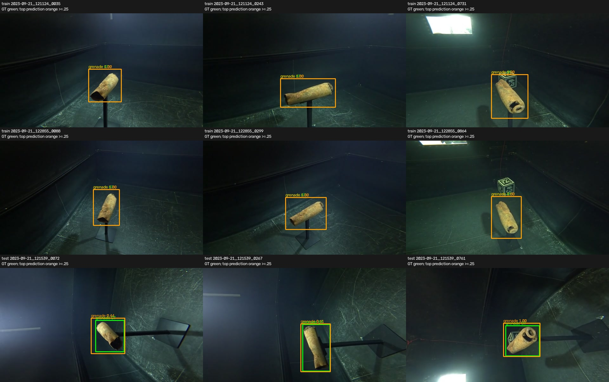

# 相机test为何仍未达到训练集表现

2026-11-14。用户追问训练场景是否仍不够。按[解释性复算登记](../../experiment/archive/camera-test-error-explanation-plan.md)，仅分析既有epoch200 raw预测与录音元数据，无新推理/训练/阈值选择或标签修改。

## 直接结论

当前存在场景内/跨录音分布差异与过拟合迹象；“训练场景不够”不能作为已证实唯一原因。八种宽场景已在train出现，这是实际已达成的覆盖标准；它不保证场景内高度、朝向、目标外观/尺度、背景组合的泛化。

相机test mAP@[.5:.95]=85.54%并不表示14.46%的图片没检出。AP50=98.68%、AP75=97.63%；mAP还平均了.80/.85/.90/.95等更严格IoU阈值。结合以下候选框复算，精细框边界与少数录音分类问题比“大量看不到目标”更符合当前证据。

## 固定候选框检查（不是AP/准确率）

score≥.25，715个单GT图：无预测0张；最高分错类15张，其中121539有14张、124735有1张。

| IoU门槛 | 至少一个任意类别候选达到门槛的图片数 | 至少一个正确类别候选达到门槛的图片数 |
|---|---:|---:|
| .50 | 715/715 | 705/715 |
| .75 | 710/715 | 699/715 |
| .90 | 553/715 | 549/715 |
| .95 | 250/715 | 250/715 |

这些是同一图内最佳候选的覆盖计数，未计排序与额外假阳性，不能当作COCO AP或总体准确率。原AP计算仍score=.01，不据诊断阈值改评价。

## 关键录音121539：宽场景已见，联合细条件仍不同

燃烧弹左右运动test121539：102帧，mAP66.85%、AP5094.06%、AP7592.96%；固定score.25下14帧最高分错类（12mortar、2bomb），正确类IoU≥.90候选仅22帧，≥.95仅4帧。

录音级名义条件对照：

| recording | role | z | tilt | roll |
|---|---|---:|---:|---:|
| 121124/121327 | train同一来源组 | 750 | −22 | 0 |
| 122855 | train（与122608同来源组） | 500 | −34 | 90 |
| 121539 | test | 750 | −22 | 90 |

因此不能说train没见过roll90，也不能说此test没有相同宽场景；缺的是该联合名义组合及足够独立来源的对应证据。这里的z/tilt/roll来自录音表，未经独立RGB/物理姿态认证，不直接等同图中真实相机转角。

实际查看上述两条train和该test各首/中/末共9帧：所看test画面朝向、目标呈现和背景布局与train有差异，预测大多能定位，但类别置信与框贴合不如训练样本。这支持场景内分布差异假设，不证明名义roll本身、背景或任何单因素是唯一原因。

## 其他因素与证据边界

- train mAP100而val89.37/test85.54说明模型可充分拟合当前训练标签，仍有跨录音落差；不应再仅称“没训练够”。
- 无增广是此首轮受控配方的实际选择，可能影响泛化，但没有无增广/有增广对照，不能宣布它已被证明是原因。
- 地面bomb test155609的名义z1250，而同场景train160551 z1000；存在细条件差异，但test AP50100/AP7593.28，mAP81.11，不能把它描述成整场景检测失败。
- 几千个相关帧不等于几千个独立来源。当前train21录音/17来源组；单场景的一条录音增帧能增曝光，不能据此认证独立条件覆盖充分。是否需追加数据，应由train/val上的独立来源/条件分析与受控对照决定。
- camera原SD框不是逐框专家重新复审的成果。高IoU评价对边界差异敏感，但本轮没有证据把全部定位误差归咎标签，也不修改GT来提升分数。

当前没有证据要求推倒重做数据集或重分角色。保留现有baseline；若验证场景内覆盖或泛化配方，使用train/val单独预登记对照。test本轮只用于解释已报告结果，不将121539挪进train，也不据test挑新增广/阈值/权重。

证据：[完整候选计数](../../runs/scene_baselines_test715_review/camera_explanation/counts.json)、[test报告](scene-baselines-test715-results.md)、[train/val报告](scene-expanded-baselines-final-results.md)。
