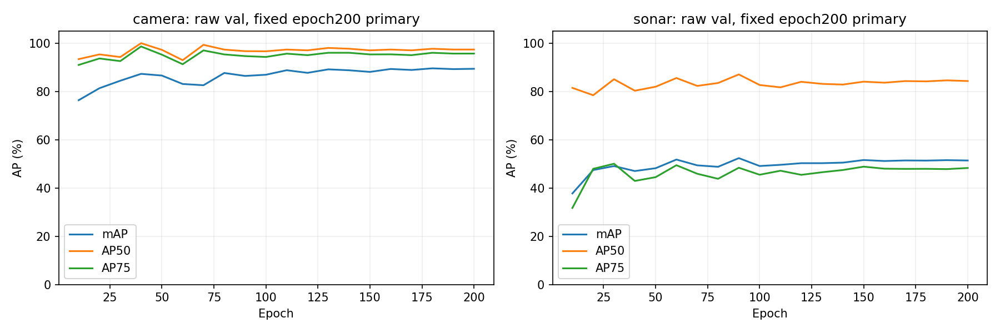

# 场景扩充后两项200epoch baseline结果

2026-11-14。camera-only YOLOX-M与sonar-only YOLOX-S，after_pilot独立run，seed0、200epoch/61800更新、2472train/894val；主结果固定epoch200 actual raw。无test评价、无新增训练、无阈值/标注/成员更改。

## 结论

两项正常完成，train自评mAP均100%。camera val mAP89.37%，多数场景较好，flyby仍有局部泛化落差；sonar val51.38%，存在更大train—val落差，迫击炮分类与部分声呐框定位失败明显。可以登记有效开发baseline，但尚不能称跨场景问题已解决。

## 固定主结果（百分数）

| 模型 | train mAP | val mAP | val AP50 | val AP75 | val AR@1 |
|---|---:|---:|---:|---:|---:|
| camera | 100.00 | 89.37 | 97.35 | 95.68 | 91.17 |
| sonar | 100.00 | 51.38 | 84.30 | 48.27 | 58.30 |

camera与sonar使用各模态图像及各自GT，二者AP差不是一种方法相对另一种方法的增益，也不是已证明的蒸馏空间。train100表示在当前标签/阈值集合上充分拟合，不认证GT专家准确率或新实例/海域泛化。

## 逐类val（百分数）

| 类别 | camera mAP/AP50/AP75 | sonar mAP/AP50/AP75 |
|---|---:|---:|
| 100lbs_aircraft_bomb | 94.28/100.00/100.00 | 78.59/99.00/87.39 |
| mortar_shell | 85.75/99.98/94.96 | 34.27/59.99/33.28 |
| incindiary_grenade | 88.08/92.08/92.08 | 41.28/93.91/24.14 |

## 逐场景val（百分数；各场景内重新pooled）

| 场景 | train/val帧 | train组/val组 | camera mAP | sonar mAP |
|---|---:|---:|---:|---:|
| 100lbs_aircraft_bomb / floor / ellipse | 115/69 | 1/1 | 94.34 | 71.87 |
| 100lbs_aircraft_bomb / floor / flyby | 78/0 | 1/0 | N/A | N/A |
| 100lbs_aircraft_bomb / standard / L_to_R | 627/241 | 4/1 | 94.26 | 80.64 |
| 100lbs_aircraft_bomb / standard / flyby | 146/0 | 1/0 | N/A | N/A |
| incindiary_grenade / standard / L_to_R | 598/212 | 3/1 | 97.36 | 42.82 |
| incindiary_grenade / standard / flyby | 108/100 | 1/1 | 68.85 | 51.84 |
| mortar_shell / standard / L_to_R | 784/252 | 5/2 | 88.74 | 38.56 |
| mortar_shell / standard / flyby | 16/20 | 1/1 | 47.15 | 0.59 |

train两模态八场景mAP均100%。无val的两种bomb flyby没有独立留出结果；不能用train自评代替。场景AP不平均替代总体AP。

## 九条val录音（百分数）

| recording | 帧数 | camera mAP | sonar mAP |
|---|---:|---:|---:|
| 2023-09-20_174200 | 116 | 94.74 | 77.71 |
| 2023-09-20_174439 | 125 | 93.99 | 83.41 |
| 2023-09-21_101416 | 120 | 89.05 | 9.36 |
| 2023-09-21_105230 | 132 | 89.03 | 58.69 |
| 2023-09-21_105856 | 20 | 47.15 | 0.59 |
| 2023-09-21_123841 | 106 | 100.00 | 45.66 |
| 2023-09-21_124039 | 106 | 95.32 | 40.68 |
| 2023-09-21_125048 | 100 | 68.85 | 51.84 |
| 2023-09-21_160146 | 69 | 94.34 | 71.87 |

## 失败表现与证据强度

- 相机燃烧弹flyby125048：mAP68.85%，AP50/AP75均77.23%。score≥.25下最高分错类46/100，100/100帧有任意类别IoU≥.75候选；较短跑分类改善但仍有bomb混淆。不能说全部100帧仍错类。
- 相机迫击炮flyby105856：mAP47.15%、AP5097.77%、AP7515.70%。score≥.25下最高分类别20/20正确，候选IoU≥.75仅8/20，并有重复/局部预测框；支持定位和预测排序问题，不是未发现目标。
- 声呐迫击炮flyby105856：mAP0.59%、AP505.94%。score≥.25下20/20最高分都为grenade，尽管20/20有任意类别IoU≥.5框、16/20有≥.75框；正确类别IoU≥.5仅1/20。主要失败表现为分类混淆。
- 声呐迫击炮左右运动101416：mAP9.36%，120帧中93帧最高分错类、1帧没有score≥.25预测；任意类别IoU≥.75候选仅21/120，分类与定位问题并存。另一条迫击炮左右运动105230 mAP58.69%，同场景跨录音差异很大。
- 声呐燃烧弹左右运动123841/124039：pooled场景mAP42.82%、AP50100%、AP7522.59%。固定图与候选IoU统计显示预测框边界偏差；各106帧最高分类别均正确，≥.75候选仅50/106与34/106，定位是可见主要表现。

上述score≥.25统计为固定诊断阈值，原AP使用score.01；候选IoU不等于COCO AP，也不能单凭AP50/AP75差唯一判断失败原因。原因仍可能涉及采集/外观分布、少来源、模型与标注边界语义；本轮不重画框或追调阈值。

## 训练过程

- 完整camera run自身epoch10→200 val mAP76.35→89.37；完整sonar run37.73→51.38。camera后段接近平台，sonar约60epoch后主要在49–52%波动；不能把当前声呐低val简单归为训练轮数不足。
- 原相机10epoch pilot是另一独立run，val68.31%，其epoch5验证频次和短跑预算不同，早期轨迹不完全相同。本文不将pilot与完整run拼为一条曲线，也不将差值全部作为单因素训练预算效应。
- 中间val波动/峰值只作为过程记录，主结果仍用预先固定epoch200 raw，不换best或EMA。

## 边界及交付

本次是单seed开发协议结果，val894来自9录音/7来源组，不支持帧级独立显著性。声呐尺寸—类别/采集设置混杂仍在；不能据bomb分数较高断言学到了通用声学语义。纯背景误报和无目标水域召回不在当前筛选数据上验证。test715未评价。

两模态各9录音首/中/末共27帧已生成，合计54个固定视图；本次实际查看相机125048/105856与声呐101416/105856/123841/124039的18帧及曲线，其余生成不等于已全量目视认证。声呐图仅为显示非等比缩放，训练输入/标签/评价坐标不变。

原始证据：[完整JSON](../../runs/scene_baselines_after_pilot_review/results.json)、[逐场景CSV](../../runs/scene_baselines_after_pilot_review/per-scene.csv)、[逐录音CSV](../../runs/scene_baselines_after_pilot_review/per-recording.csv)。train自评权重身份与metrics位于各after_pilot/train/train_actual_raw_epoch200，最终val在val_actual_raw_epoch200。

当前两训练服务已退出，无训练重启；仅补做train自评和现有预测分组复算。
